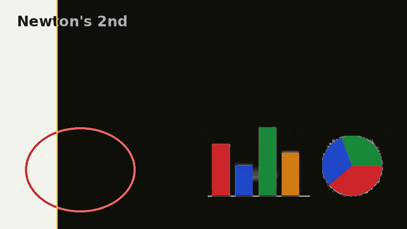
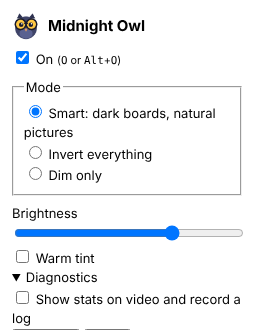

<div align="center">


# Midnight Owl

**Watch lectures at midnight.**<br>
Press <kbd>O</kbd>. Whiteboards turn dark. Faces, photos and colours stay as they are.

[](https://github.com/OmiChrome/Video-Invert-Color/releases/latest)
[](https://omichrome.github.io/Video-Invert-Color/)
[](#install)
[](#install)




</div>

## Use

| | |
|---|---|
| <kbd>O</kbd> | On / off, on any page with a video |
| <kbd>Alt</kbd> + <kbd>O</kbd> | Same, from anywhere in the browser |
|  | Bright while it is darkening a video, grey otherwise |



| Mode | |
|---|---|
| **Smart** (default) | Paper and the lines on it flip. Everything else stays. |
| **Invert** | The whole video flips, colours kept |
| **Dim** | Darker, nothing flips |

## Install

**[Download the latest release](https://github.com/OmiChrome/Video-Invert-Color/releases/latest)**. Store listings for Firefox and Edge are on the way.

- **Edge / Chrome:** unzip, open `edge://extensions` or `chrome://extensions`, turn on Developer mode, **Load unpacked**
- **Firefox:** `about:debugging` → This Firefox → **Load Temporary Add-on** → pick the zip

## Develop

```bash
python3 build.py       # zips in dist/
node test/run.js       # end-to-end tests in Chromium
```

[How it works](research/README.md) · [Publishing](docs/PUBLISHING.md) · [Website source](site/)

## License

[MIT](LICENSE) © OmiChrome. Use it, change it, fork it; just keep the credit.
