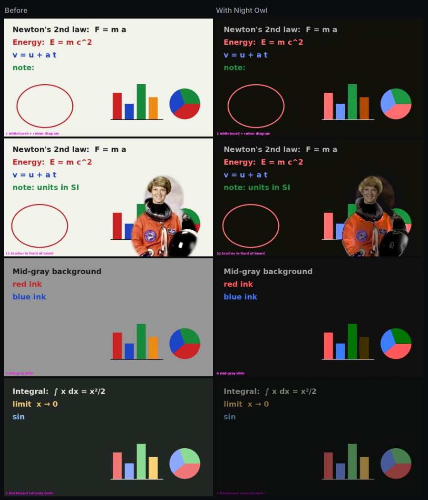

<div align="center">


# Night Owl

**Watch whiteboard lectures in a dark room.**
Bright boards turn dark. Faces, photos and colours stay natural.

[](#install)
[](#install)
[](#install)
[](#install)




</div>

## Use

| Key | |
|---|---|
| <kbd>O</kbd> | On / off, on any page with a video |
| <kbd>Alt</kbd> + <kbd>O</kbd> | Backup shortcut (change it in `chrome://extensions/shortcuts`) |

The toolbar owl **lights up** when it is darkening a video and goes **grey** when it isn't.


| Mode | |
|---|---|
| **Smart** (default) | Only bright boards flip to dark |
| **Invert** | Whole video flips, colours kept |
| **Dim** | Darker, nothing flips |

## Install

Store links arrive once the listings are approved. Until then, load it yourself:

1. Download or clone this repo
2. Open `chrome://extensions`, turn on **Developer mode**
3. Click **Load unpacked** and pick the `extension` folder

Firefox: `about:debugging` → **This Firefox** → **Load Temporary Add-on** → `dist/firefox/manifest.json` (after `python3 build.py`).

## Develop

```bash
python3 build.py      # store zips in dist/
node test/run.js      # end-to-end tests in Chromium
```

Try every mode side by side in the lab: `research/lab/` · How it works: [`research/`](research/README.md) · Publishing: [`docs/PUBLISHING.md`](docs/PUBLISHING.md)
