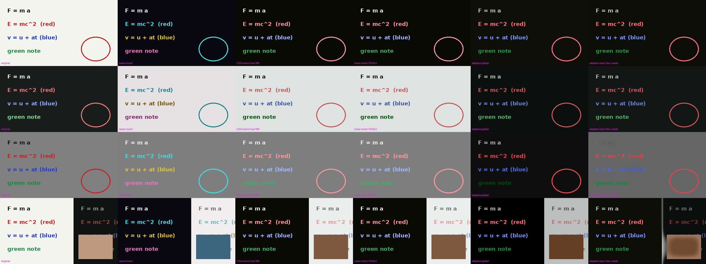

# Night Lecture Mode: research and plan

Goal: a very small browser extension that makes lecture videos comfortable to watch in a
pitch-dark room. Whiteboard videos become dark; blackboard and dark videos **stay** dark;
nothing ever "flashbangs" the viewer.

Status: research done, nothing implemented yet. Prototype code and results are in `docs/research/`.

---

## 1. Why plain "invert colors" isn't enough

| Problem | Effect |
|---|---|
| `invert(1)` flips hue as well as brightness | Red marker turns cyan and blue turns yellow, so color-coded lectures stop making sense. |
| A dark scene (blackboard, dark slide, camera cut) gets inverted too | It turns almost white. That flash is the thing we're trying to prevent. |
| A mid-gray background stays mid-gray when inverted | The frame is still bright (about 50% luminance), so it isn't comfortable in the dark. |
| A mixed frame (white slide plus dark camera inset) | Whichever choice you make, some region ends up bright. |

## 2. Algorithms compared (prototype: `docs/research/proto.py`)

Each algorithm ran on four synthetic frames: a whiteboard, a blackboard, a mid-gray background, and a mixed slide with a camera inset.



Columns: original · naive invert · CSS `invert(1) hue-rotate(180deg)` · luma-only invert · **adaptive global** · adaptive local (blur mask)

Mean output luminance (0 = black, 1 = white). Lower is better, as long as the text stays readable:

| frame | naive invert | luma invert | **adaptive global** | adaptive local |
|---|---|---|---|---|
| whiteboard | 0.065 | 0.064 | **0.078** | 0.071 |
| blackboard | 0.868 ❌ | 0.868 ❌ | **0.076** | 0.103 |
| mid-gray | 0.506 ❌ | 0.505 ❌ | **0.072** | 0.402 ❌ |
| mixed | 0.328 | 0.328 | **0.239** | 0.113 (edge halos) |

**Conclusion:** use the adaptive global algorithm by default. Adaptive local handles mixed frames best,
but it washes out mid-gray backgrounds, draws halos at region edges, and costs a large blur on every frame.
It stays an optional idea for later (§8).

### 2.1 The core transform: "anchored luma remap" (a single SVG `feColorMatrix`)

Work in luma/chroma terms. With luma `Y = 0.2126R + 0.7152G + 0.0722B` (Rec.709, which YouTube uses):

```
Y' = a + b·Y                     # remap brightness only
c' = s·c + (a + (b − s)·Y)·[1,1,1]   # per channel; keeps hue, s = saturation gain
```

The whole thing is **linear**, so it fits in **one 4×5 `feColorMatrix`**. It runs as a native filter with
no per-pixel JavaScript:

```
R' = (s + k·wr)R + (k·wg)G + (k·wb)B + a        where k = b − s
G' = (k·wr)R + (s + k·wg)G + (k·wb)B + a
B' = (k·wr)R + (k·wg)G + (s + k·wb)B + a
```

- With `b = −1, a = 1, s = 1` this is a pure luma inversion. White becomes black, but **red stays red-ish
  and blue stays blue-ish**. Compare columns 2 and 4 in the image: naive invert turns red cyan, luma invert keeps it red.
- `a` and `b` are chosen so the **detected background maps to `Y_T ≈ 0.06`** (near black) and the
  strongest content maps to **at most `Y_CAP ≈ 0.80`**. Text stays readable but is never full white at night.
- A warm/low-blue tint (lower B gain) and brightness cap can be folded into the same matrix at no extra cost.

### 2.2 Choosing `a`, `b` per scene (tiny sampler, ~4 Hz)

1. About every 250 ms, **only while the video is playing, visible and the mode is on**, `drawImage` the
   video into a **48×27 canvas** and read about 1.3k pixels. This costs microseconds.
2. Take the **median luma `Y_b`**. The median ignores ink and text and gives the background.
3. **Polarity, with hysteresis:** invert when `Y_b > 0.55`, return to normal when `Y_b < 0.40`. In between,
   keep the current state. This stops flicker on gray frames.
   - Bright background: `b = −(Y_CAP − Y_T)/Y_b`, `a = Y_T − b·Y_b`
   - Dark background: keep polarity and only cap highlights and lift the floor to `Y_T`
4. **Bright-area guard** (for mixed frames): estimate the fraction of the output frame above 0.4. If it's above
   about 15%, lower `Y_CAP` and the gain until it isn't. This handles the leftover bright camera inset in the mixed frame.
5. **Transitions:** parameters ease over about 300 ms. A polarity flip, such as a scene cut from whiteboard to
   camera, passes through **dark** (fade to `Y_T` and back) and never through gray or white. Eye-safe by construction.
6. **Fallback:** if the canvas is cross-origin-tainted (some non-YouTube embeds), use a fixed luma invert plus
   cap, with a manual "force invert / dim only" option. YouTube uses MSE `blob:` media, so it is readable. This still needs to be confirmed in testing.

## 3. Architecture (lightweight-first)

```
manifest.json          MV3; permissions: storage, activeTab, scripting
content.js  (~150 LOC) only on youtube.com (+ sites the user opts into)
background.js (~20)    command handler; injects content.js on other sites on demand (activeTab)
popup.html             native <input type=range>/<select> controls, almost no CSS
```

- **HTML/SVG over JS/CSS:** the effect is one inline `<svg><filter><feColorMatrix>` plus one
  `filter:url(#nlm)` on the `<video>`. JavaScript only does the toggle and the 4 Hz sampler, and updates one
  `values` attribute when the parameters actually change.
- **Zero cost when off:** the filter is removed, the sampler stops, no observers run. On sites other than
  YouTube, nothing is injected until you press the shortcut.
- Works in YouTube fullscreen (the player container goes fullscreen and the `<video>` keeps its filter) and
  across YouTube's SPA navigation (it re-attaches on the `play` event).
- Chrome first, with Firefox from the same MV3 code. Safari is out of scope: it has known bugs with SVG filters on `<video>`.

## 4. Keybinds (researched)

| Candidate | Verdict |
|---|---|
| **Ctrl+I** | ❌ Firefox: Page Info. Everywhere: *italic* in editors (YouTube comments, Gmail, Docs). |
| **O** (single key) | ✅ with guards. YouTube's official shortcut list has no `o`. A legacy, undocumented `o` cycles caption text opacity. We would override that only while a video is on the page. |
| Alt+Shift+I | ❌ Chrome uses it for "Send feedback". |
| **Alt+Shift+O** | ✅ Free in Chrome and Firefox by default. Registered through `chrome.commands`, so you can rebind it at `chrome://extensions/shortcuts`. |

**Plan:** `O` toggles on YouTube. It is ignored when typing in an input, textarea or contenteditable, when any
modifier is held, and on pages without a `<video>`. It is caught in the capture phase so YouTube doesn't also act on it.
**Alt+Shift+O** works on any site, including pages where the content script isn't loaded yet.

## 5. Test plan: generated demo video

Generate a demo video with `ffmpeg` using a lavfi color source plus `drawtext`, about 60 s, with these segments:
whiteboard → hard cut to blackboard → mid-gray → mixed slide+camera → whiteboard with fast cuts (flicker test)
→ a fade from black to white.

Automate it with Playwright and Chromium, with the extension loaded, on a local test page and on YouTube:
- every segment: output mean luma ≤ 0.12 and 95th-percentile ≤ 0.85
- **no flash:** the frame-to-frame jump in mean output luma never exceeds about 0.08
- color preservation: red ink stays red (hue error < 20°)
- performance: content-script CPU < 1% while playing; no dropped-frame regression compared with the extension off
- keys: `O` doesn't fire while typing in YouTube search or comments; Alt+Shift+O works

## 6. Milestones

1. Static luma invert with `feColorMatrix` plus the `O` and Alt+Shift+O toggles (an MVP you can use straight away)
2. Adaptive sampler: median, hysteresis, dip-to-dark transitions
3. Bright-area guard plus warm-tint and brightness-cap settings in the popup
4. Demo video plus the Playwright test suite; tune the thresholds
5. Firefox packaging

## 7. Open questions for you

1. Is `O` on YouTube plus Alt+Shift+O elsewhere fine, or do you want `O` on every site?
2. Should the on/off state persist per site, so YouTube remembers it was on?
3. Should a warm, low-blue tint be on by default?

## 8. Optional later

Local / region-adaptive mode for split-screen lectures. It would use a coarse per-cell polarity mask, built
from the same 48×27 sample, fed to an `feImage` and blended with `feComposite`. It's only worth adding if the
bright-area guard turns out to be insufficient on real videos.
